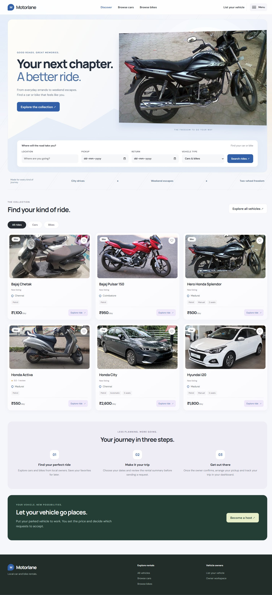
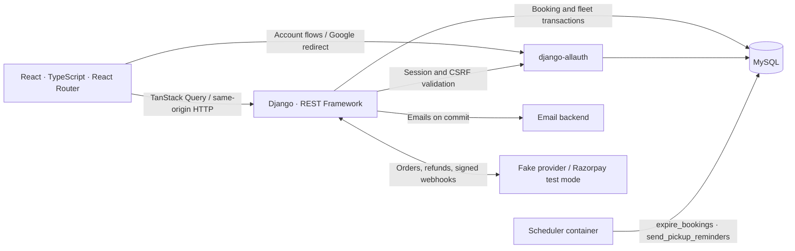

# Motorlane - Vehicle Rental Marketplace

[GitHub repository](https://github.com/priyadharshanexe/motorlane)

Browse cars and bikes, request a rental for selected dates, and follow the
booking through pickup and return. Vehicle owners manage their fleet,
availability, incoming requests, maintenance, and completed booking value.



Screenshots from 18 November 2026 predate the switch to real vehicle photographs. Signed-in pages use demo accounts.

## Architecture



Vite builds the React application. Django serves the SPA under `/app/` and
the root redirects there. The SPA, API, and account endpoints share the same
origin. The browser uses Django's HttpOnly session cookie and passes a CSRF
token for unsafe requests. Google returns through django-allauth's provider
callback. Django Admin remains available under `/admin/`.

The backend is layered: `rental/api.py` only parses requests and serializes
responses; business rules live in `rental/services/` (booking, pricing,
availability, payments in `rental/payments/`, notifications, expiry, photos,
listing, maintenance), read queries in `rental/selectors.py`, and access scoping
in `rental/permissions.py` (rows another account owns answer 404).

Django prices every rental server-side and validates final availability on
submission. Bookings have pickup and return times; a configurable cleaning
buffer (`RENTAL_TURNAROUND_MINUTES`, default 120) separates rentals and
maintenance. MySQL row locks serialize conflicting reservations, maintenance
and listing-cap checks. A pending request holds its dates for up to 24 hours.
Vehicle archiving preserves booking history.

Pricing: weekend rate for Saturdays and Sundays when set, 10% off 7+ days and
20% off 30+ days, and a refundable deposit shown as its own line. The quote is
returned line by line and stored on the booking.

Payments (test only): after approval the renter pays rental plus deposit
through the built-in fake provider, or Razorpay when `rzp_test_` keys are set
(live keys are refused). Pickup needs a completed payment. Cancelling at least
48 hours before pickup refunds everything; later, 20% of the rental is kept and
the deposit is returned. The deposit is refunded at return. Webhooks are
verified by HMAC signature and each provider event id is applied once.

### Data model

| Model | Purpose |
| --- | --- |
| `Profile` | Marketplace details (phone) for an auth user; name and email live on the user |
| `Vehicle`, `VehiclePhoto` | Listings with weekday/weekend rates and deposit; up to eight photos, one cover, WebP thumbnails at 400 and 1200 px |
| `Booking` | Dates and times, status (Pending, Confirmed, Rejected, Expired, Cancelled, In progress, Returned), stored price breakdown |
| `BookingEvent` | Append-only timeline: every creation, transition and expiry with actor and note |
| `MaintenanceBlock` | Whole-day unavailability set by the owner |
| `Feedback` | One verified review per returned booking, rating 1 to 5 (database constraints) |
| `Payment`, `Refund`, `WebhookEvent` | Charge, refunds and processed provider event ids |
| `Favorite` | Saved vehicles |

Emails (text and HTML, sent after commit): new request to the owner; approved,
rejected and cancelled to the renter; a pickup reminder the day before; return
received and a review request.

## Run locally

Requires Python 3.11, Node 22.12+, and MySQL 8.4. Docker can provide MySQL.

1. Copy `.env.example` to `.env`. Set a unique `DJANGO_SECRET_KEY`, choose a local
   `MYSQL_PASSWORD`, and set `DJANGO_DEBUG=1`. Use `MYSQL_HOST=127.0.0.1` and a
   free `MYSQL_PORT`.
2. Start MySQL with `docker compose up --wait db`, or create the database and
   application user yourself. The Compose service also grants access to
   Django's test database.
3. Create a Python virtual environment and run
   `python -m pip install -r requirements.txt`.
4. Run `npm --prefix frontend ci` and `npm --prefix frontend run build`.
5. Run `python manage.py migrate` and `python manage.py runserver`.
6. Open [the local marketplace](http://127.0.0.1:8000/).

For frontend development, start Django on port 8000 and run
`npm --prefix frontend run dev`. Open the Vite URL under `/app/`. Vite proxies
the API and account routes to Django. Use the same-origin built app to test
Google callbacks and email links.

## Docker

With the local environment configured, run:

```sh
docker compose --profile app build web
docker compose up --wait db
docker compose --profile app run --rm web python manage.py migrate
docker compose --profile app up -d web scheduler
```

The `scheduler` service runs `python manage.py run_scheduled_jobs` every
`SCHEDULER_INTERVAL_SECONDS` (default 300). The jobs are idempotent, so a restart
or a second instance is harmless. `expire_bookings` marks pending requests whose
24-hour response window or pickup date has passed as Expired, and confirmed
bookings that were never picked up by the end of their rental window as Expired
(owners may record a late pickup until then). Each change is written to the
booking's timeline. Run a job by hand with
`docker compose --profile app exec scheduler python manage.py expire_bookings`.

The web image builds React, collects static files, and serves Django through
Gunicorn. For production, set `DJANGO_DEBUG=0`, supply secrets through the
runtime environment, set `DJANGO_ALLOWED_HOSTS`, and place the app behind HTTPS.
Enable `DJANGO_TRUST_HTTPS_PROXY=1` only when your proxy overwrites
`X-Forwarded-Proto`. Serve persistent uploaded media from the proxy or a
dedicated media service. Configure SMTP with the `DJANGO_EMAIL_*` settings and
set `DJANGO_FROM_EMAIL`. Local debug mode prints account email to the console.

Google sign-in uses `GOOGLE_CLIENT_ID` and `GOOGLE_CLIENT_SECRET` when
configured. Register the callback at
`/accounts/google/login/callback/` for the exact host, scheme, and port.

## API overview

| Endpoint | Purpose |
| --- | --- |
| `GET /api/v1/session/` | Browser session and CSRF token |
| `GET /api/v1/vehicles/` | Date-aware catalog with filters and pagination |
| `GET /api/v1/vehicles/{id}/` and `/quote/` | Listing details, blocked dates, reviews, and server quote |
| `GET, POST /api/v1/bookings/` | Customer booking history and rental requests |
| `POST /api/v1/bookings/{id}/{action}/` | Cancel, approve, reject, record pickup, or record return |
| `POST /api/v1/bookings/{id}/review/` | Review a completed rental |
| `GET /api/v1/owner/bookings/` and `/owner/value/` | Owner rental queue and completed booking totals |
| `GET, POST /api/v1/owner/fleet/` | Owner listings and multipart creation |
| `PATCH, DELETE /api/v1/owner/fleet/{id}/` | Update, publish, unpublish, or archive a listing |
| `/api/v1/owner/fleet/{id}/maintenance/` | List or create maintenance blocks, with deletion by block ID |
| `GET /api/v1/bookings/{id}/` and `/timeline/` | Booking with its audit timeline (renter or owner) |
| `GET /api/v1/bookings/{id}/cancellation/` | Fee and refund if cancelled now |
| `POST /api/v1/bookings/{id}/payment/` and `/payment/confirm/` | Open checkout and confirm a signed result |
| `POST /api/v1/payments/webhook/` | Provider webhook (signature verified, idempotent) |
| `/api/v1/owner/fleet/{id}/photos/` | Upload, reorder, set cover or delete photos |
| `/auth/browser/v1/` | django-allauth browser authentication and account APIs |
| `GET /healthz`, `GET /readyz` | Liveness, and readiness (database and migrations) |

The full OpenAPI schema is at `/api/schema`, with interactive docs at
`/api/docs`. Catalog search accepts `location` (comma-separated places),
`min_price`, `max_price`, `sort` (`price`, `-price`, `rating`, `newest`),
dates and `pickup_time`/`return_time`.

## Demo and tests

Set `RENTAL_DEMO_PASSWORD` to a disposable password of at least 12 characters
with `DJANGO_DEBUG=1`, then run `python manage.py seed_demo`. For Docker, use
`docker compose --profile app run --rm -e RENTAL_DEMO_PASSWORD web python manage.py seed_demo`
with the password exported in your shell.

The seed creates renter and owner accounts at `rental-demo.example`, with
upcoming, active and historical bookings. After seeding, run
`python manage.py refresh_demo_catalog` to populate eight complete illustrative
listings with distinct photographs. The command updates its demo records on reruns.
Its optional `--archive-existing` flag archives other visible listings while
preserving booking history. Use a disposable local database for demo setup.

The demo catalog spans four cars and four bikes across Tamil Nadu. Specifications,
prices and pickup instructions are sample data. Vehicle photographs are real,
openly licensed Wikimedia Commons images credited in [CREDITS.md](CREDITS.md).

Run `python manage.py test`, `npm --prefix frontend test`,
`npm --prefix frontend run lint`, and `npm --prefix frontend run build`.
The Django suite (100+ tests) covers every status transition and permission,
pricing, expiry, notifications, payments and duplicate webhooks, concurrency
on MySQL, and a full rental through the API. CI runs settings checks,
migration checks (forward and reverse), OpenAPI validation and the suite on
MySQL, builds the Docker image and probes the running stack, and checks the
TypeScript application.

Production settings: HSTS for one year with preload, a Content-Security-Policy
with per-request script nonces, JSON log lines (`DJANGO_LOG_FORMAT`), pooled
database connections (`DJANGO_CONN_MAX_AGE`), and `manage.py check` validation
of rental and payment settings.

[Catalog](docs/screenshots/catalog.jpg) · [Booking details](docs/screenshots/booking.jpg) · [Owner workspace](docs/screenshots/owner.jpg) · [Demo photo credits](rental/demo_images/CREDITS.md)

## License

Application code and project documentation use the [MIT license](LICENSE).
Bundled photographs retain their original licenses. See [all image credits](CREDITS.md)
and the [demo photograph attributions](rental/demo_images/CREDITS.md) for file-level details.
